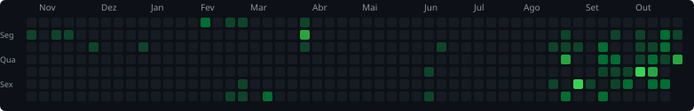

---

## 👋 Sobre mim

Sou aluno do 3º ano do Técnico em Desenvolvimento de Sistemas na **EEEP Professor Sebastião Vasconcelos Sobrinho** e **estagiário na Proserv Consultoria**, onde ajudo a criar sistemas internos de controle. Curto aprender de tudo um pouco e meu plano é virar **Full Stack**, com calma e um passo de cada vez.

🥇 **Menção Honrosa** no Desafio dos Dados 2025, entre mais de 340 equipes
 🥉 **Medalha de Bronze** na Olimpíada Brasileira de Tecnologia (OBT), com o WasTech

---

## 🚀 Projetos em destaque

<table>
<tr>
<td width="50%" valign="top">

### 🌱 WasTech
Plataforma de tecnologia e sustentabilidade para a agricultura, feita em equipe, com dados climáticos da NASA POWER.

   

[📂 Repositório](https://github.com/Aderlangio123/wast-tech-completa)

</td>
<td width="50%" valign="top">

### ⚽ API de Seleções
API REST com CRUD completo de seleções de futebol. Banco MySQL no Railway e API no Render.

  

[🌐 API no ar](https://api-selecoes-nodejs.onrender.com/selecoes) · [📂 Código](https://github.com/Aderlangio123/api-selecoes-nodejs)

</td>
</tr>
<tr>
<td width="50%" valign="top">

### ✅ FocusFlow
Gerenciador de tarefas com filtros (todas, pendentes, concluídas), Context API, Custom Hooks e LocalStorage.

 

[🌐 Demo](https://focus-flow-tarefas.vercel.app) · [📂 Código](https://github.com/Aderlangio123/FocusFlow-Tarefas)

</td>
<td width="50%" valign="top">

### 🎮 Galeria de Jogos
Feita em dupla com o Emanuel, consome a API FreeToGame com busca, filtros e tela de detalhes.

  

[🌐 Demo](https://biblioteca-games-nfcz.vercel.app) · [📂 Código](https://github.com/emanuel378/BibliotecaGames)

</td>
</tr>
</table>

---

## 🛠️ Tecnologias

---

## 📊 Atividade no GitHub

